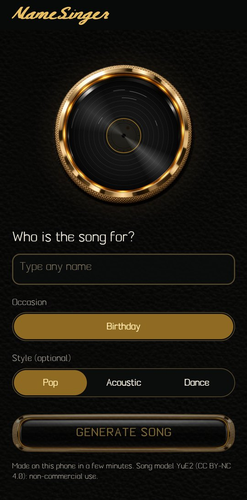
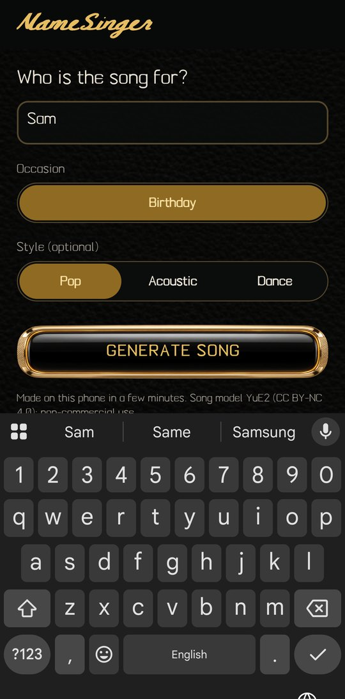
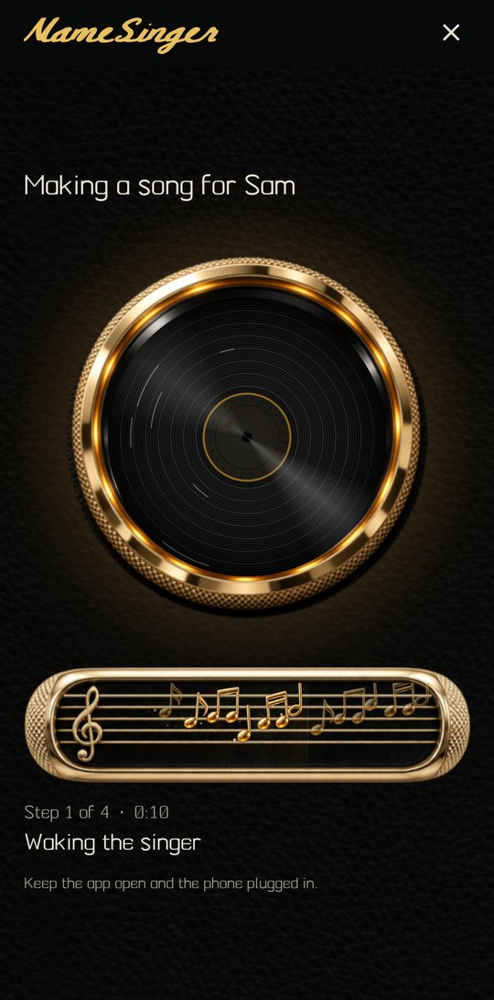
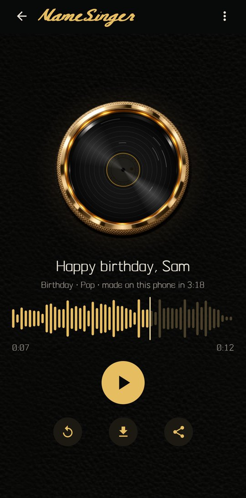
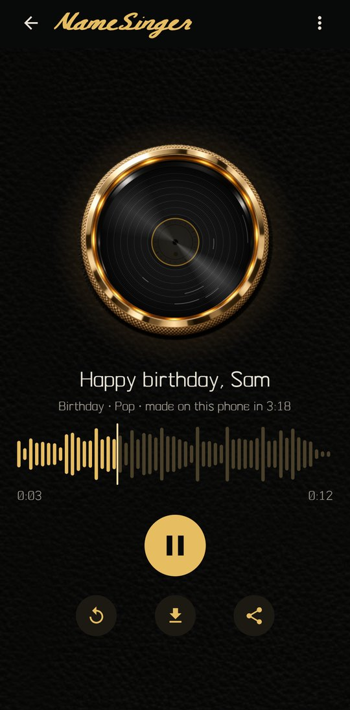
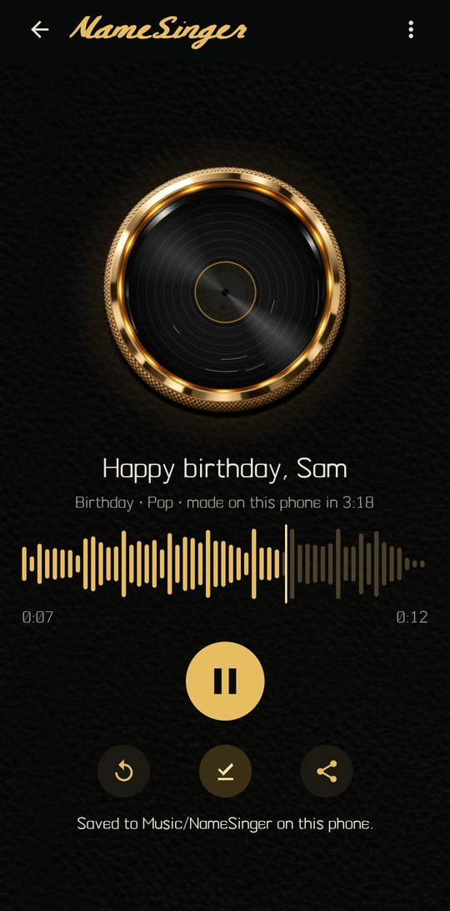

<p align="center">
  
</p>

<h3 align="center">Type a name. Your phone sings it.</h3>

<p align="center">
  <a href="https://github.com/NITISH-R-G/NameSinger/releases/download/v0.2.0/NameSinger-v0.2.0-debug-arm64.apk">
    
  </a>
  <br>
  <sub><b>v0.2.0 prototype</b> · debug build, not a Play Store release · arm64 · 51 MB · tested on Android 16 ·
  <a href="https://github.com/NITISH-R-G/NameSinger/releases/tag/v0.2.0">release notes and checksum</a></sub>
</p>

---

NameSinger makes a personalised birthday song in which **the name you type is sung**, and it does it entirely on your phone. There is no server,
no account and no per-song cost: a 3.6-billion-parameter music model (YuE2) runs on the phone's CPU and takes three to four minutes to write and
render a short song. You pick a name, an occasion and (optionally) a style, press Generate, and watch the song being made. When it is done you can play it,
replay it, save it to your Music folder and share it.

> **Prototype.** This is a working technical demonstration on one device. Pronunciation of names is not reliable yet (see [Known limitations](#device-requirements-and-limitations)),
> and the AI model's licence is non-commercial (see [Licensing](#licensing-and-acknowledgements)).

## Screenshots

<table>
  <tr>
    <td align="center"><br><sub><b>Create</b><br>name, occasion, style</sub></td>
    <td align="center"><br><sub><b>Name input</b></sub></td>
    <td align="center"><br><sub><b>Generating</b><br>real step and elapsed time</sub></td>
  </tr>
  <tr>
    <td align="center"><br><sub><b>Song ready</b><br>one record, waveform, play</sub></td>
    <td align="center"><br><sub><b>Playback</b><br>pause, replay, seek</sub></td>
    <td align="center"><br><sub><b>Save and share</b><br>icon-only actions</sub></td>
  </tr>
</table>

## How it works

1. **You type a name.** NameSinger estimates its syllables and writes an ABC music score for the standard birthday tune, with the name given as many notes as it has syllables.
2. **The lyrics are sent as text.** "Happy birthday to you / Happy birthday dear *NAME* / Happy birthday to you", plus the style tags, go to the model exactly as spelled. The model has no
   pronunciation dictionary: the name is sung from its spelling.
3. **YuE2 composes and sings.** The language model turns the lyrics and score into a stream of audio tokens (step 2), a second pass paints the voice and band from those tokens (step 3),
   and a decoder turns the result into sound (step 4).
4. **Honest progress.** The screen shows the real stage ("Step 3 of 4", "Render pass 2 of 4"). It never shows an invented percentage.
5. **You get an MP3** you can play, replay, save to `Music/NameSinger` and share.

## AI model and technical architecture

| | |
|---|---|
| Song model | **YuE2 3B**, quantized **Q5_K_M**, 2.62 GB (`YuE2-3B-Q5_K_M.gguf`) |
| Audio decoder | **YuE2 VAE, F32**, 0.53 GB (`YuE2-Vae-F32.gguf`), not quantized by design |
| Inference | **On-device, CPU only** (4 threads on the test phone), no GPU, no network |
| Engine | yue2.cpp (ggml), prebuilt arm64 libraries from the Killa YuE 1.8.1 release, run as a child process |
| App | React Native / Expo SDK 58 (TypeScript), Android |
| Storage | 3.15 GB of models in the app's private storage, plus the 51 MB app |

```
React Native UI  ──►  yue-engine module (Kotlin)  ──►  yue2 server process (CPU)  ──►  MP3
 name · style          starts the engine, POST /synth     score → tokens → render → decode
 progress              polls the job, saves the file      on 127.0.0.1, never leaves the phone
```

* `modules/yue-engine`: runs the engine and its HTTP job API, saves to `Music/NameSinger` and shares via the system sheet.
* `modules/killa-ui`: native views (buttons, field, staff animation, player) built from Killa YuE's Apache-2.0 UI classes and artwork, adapted for NameSinger.
* `src/song`: the score and lyric builder (golden-tested), the generation hook and the progress parser.

Measured on the test phone (Nothing A001, 4 render steps): a 12 s song took about 3 minutes (load 3.7 s, token prefill 10 s, melody 45 s, **voice render 27 to 35 s per pass**,
decode 15 to 20 s). Details and the render-step trade-off: [`docs/MODEL_BASELINE.md`](docs/MODEL_BASELINE.md).

## Example song

▶ **[Listen: "Happy birthday dear Sam", Pop style (MP3, 12 s)](docs/demo/sam-birthday-pop.mp3?raw=true)**
· [download](https://github.com/NITISH-R-G/NameSinger/raw/master/docs/demo/sam-birthday-pop.mp3)

Generated on the phone by this build. It is a real, unedited output; judge the pronunciation by ear. A speech recogniser transcribed the name as "Sam", which is a weak check only.

## Installation

1. **Install the app.** Download the APK from the button above and open it on an arm64 Android phone (allow installs from your browser or file manager when asked).
   It is a debug build, so Android may show a warning.
2. **Put the models on the phone.** This prototype has no in-app downloader yet. Download `YuE2-3B-Q5_K_M.gguf` and `YuE2-Vae-F32.gguf` from the
   [YuE2 GGUF release by Serveurperso](https://huggingface.co/Serveurperso/YuE2-GGUF), then with a computer and USB debugging, one file at a time (you need about 3.3 GB free for each copy step):

   ```bash
   adb push YuE2-3B-Q5_K_M.gguf /data/local/tmp/
   adb shell chmod 644 /data/local/tmp/YuE2-3B-Q5_K_M.gguf
   adb shell run-as com.namesinger.app mkdir -p files/models
   adb shell run-as com.namesinger.app cp /data/local/tmp/YuE2-3B-Q5_K_M.gguf files/models/
   adb shell rm /data/local/tmp/YuE2-3B-Q5_K_M.gguf
   # repeat for YuE2-Vae-F32.gguf
   ```
3. Open NameSinger, type a name and press **Generate song**. Keep the app open and the phone plugged in.

Build from source (Windows): see [`scripts/build-gold-apk.ps1`](scripts/build-gold-apk.ps1) and [`docs/DELIVERY_2026-11-11.md`](docs/DELIVERY_2026-11-11.md).

## Device requirements and limitations

* **Tested only on one phone:** Nothing A001 (CMF Phone 2 Pro), Dimensity 7300 Pro, 8 GB RAM, Android 16. Other phones are untested. On that phone the engine used up to about 2.5 GB of memory (including memory-mapped model pages) and 3.2 GB of storage; arm64 only. The engine libraries target Android 9 or newer, but only Android 16 has been tested.
* **Slow:** three to four minutes per song, on the CPU. The app must stay open (backgrounding is untested).
* **Pronunciation is not solved.** The model only sees the name as spelled text. Some names are sung well, others are misheard (a recogniser heard "Anna" for "Emma").
  Only human listening can judge a result; 12 screening outputs were inconclusive.
* **Short songs:** about 11 to 16 seconds (one verse of the birthday song).
* **Only the Birthday occasion**, and only the Pop style has been tuned; Acoustic and Dance use untested style tags.
* **Manual model install** (above); the in-app model download is not built yet.
* Debug build: not signed for the Play Store.

## Licensing and acknowledgements

> ### ⚠️ Not cleared for commercial use
> The Apache-2.0 licence below covers **this repository's source code only**. The **YuE2 model weights** the app needs are licensed
> **CC BY-NC 4.0 (non-commercial)** and are **not** covered by Apache-2.0. Do not treat the complete product as commercially cleared: a company
> must obtain a licence from the YuE2 authors (or use a commercially licensed model) before offering it commercially.

**Application code vs. model weights are licensed differently.**

| Part | Licence |
|---|---|
| NameSinger application source (this repository) | Apache License 2.0, see [`LICENSE`](LICENSE) and [`NOTICE.md`](NOTICE.md). Source code only |
| **YuE2 model weights (not in this repository)** | **CC BY-NC 4.0: non-commercial use only.** Individuals may use and share what they generate; a company needs a licence from the model authors. Not cleared for commercial distribution. |
| Killa YuE UI classes and artwork reused in `modules/killa-ui`; prebuilt engine libraries | Apache-2.0, Copyright 2026 JackKnifeAI. Changes are listed in [`NOTICE.md`](NOTICE.md) |
| Typefaces Killa Gel Bold Script and Killa Meridian Text | SIL Open Font License 1.1 |
| yue2.cpp and ggml (inside the engine libraries) | MIT |

No model weights, API keys or personal data are in this repository. See [`NOTICE.md`](NOTICE.md) for the full third-party list.

Thanks to **M-A-P** for YuE2, **Serveurperso** for yue2.cpp and the GGUF conversions, and **JackKnifeAI** for Killa YuE, whose open design language and engine builds this prototype stands on.
NameSinger is independent of, and not endorsed by, any of them.
